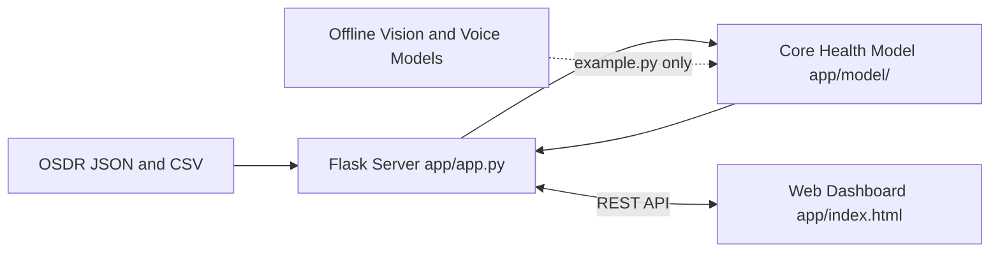

# HMS-of-A Documentation

Conceptual documentation and diagrams for the Health Monitoring System of Astronauts.

## Files

- `program-flow.md` : Application architecture, runtime modes, telemetry loop, and API flow
- `health-model.md` : Core physiological and environmental scoring engine and anomaly network
- `camera-voice-models.md` : Standalone offline vision and voice AI models
- `space-camera.md` : Conceptual space-ready camera and edge hardware for local AI models

## System Overview

HMS-of-A separates the real-time orbital dashboard from optional offline camera and voice inference.

## Components

- `app/app.py` : Serves the web UI, runs the live telemetry worker, and exposes REST endpoints
- `app/js/` : Renders commander and astronaut views, SVG charts, and standalone browser simulation
- `app/model/` : Evaluates 20 metrics across 7 domains using thresholds, personal baselines, and an autoencoder
- `local_camera_models/` : Offline CPU models for face landmarks, eye state, emotions, rPPG, and speech biomarkers
