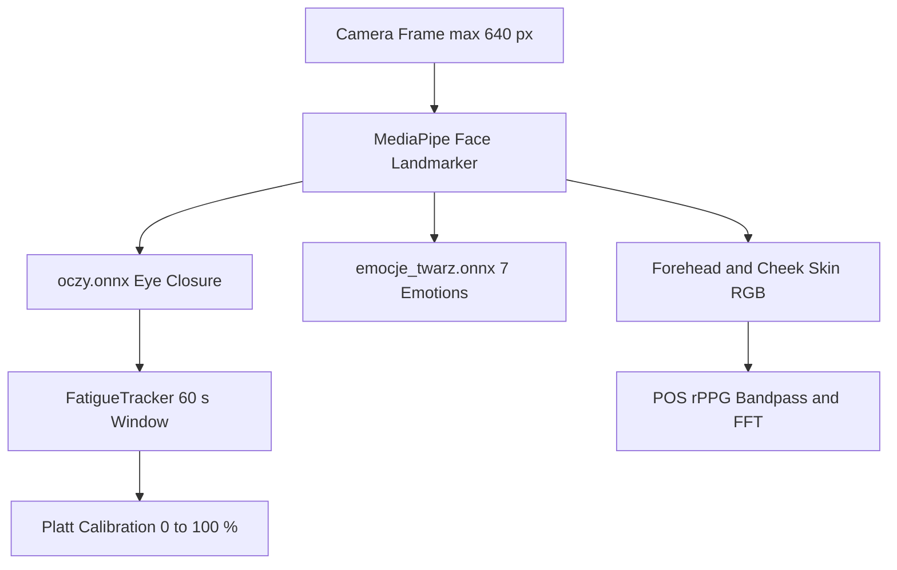
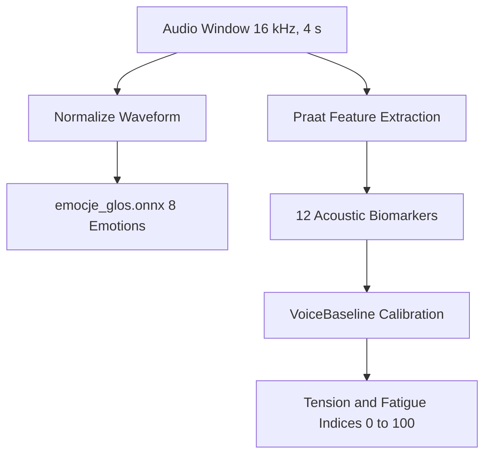

# Local Camera and Voice Models

The `local_camera_models/` directory holds standalone offline CPU models. They are excluded from the main Flask dashboard and demonstrated in `local_camera_models/example.py`.

## Vision Pipeline

Video frames resized to max width 640 px pass through MediaPipe Face Landmarker before feeding four specialized analyzers.

- `oczy.onnx` : Binary eye openness model trained on MRL Eye dataset
- `emocje_twarz.onnx` : Facial expression classifier trained on FER-2013 across 7 classes
- `konfig.json` : Stores YawDD yawn threshold `MAR_YAWN` and UTA-RLDD Platt scaling coefficients `ZMECZENIE_PLATT`
- `rppg_heart_rate` : Extracts pulse wave from skin color oscillations using Plane-Orthogonal-to-Skin projection

## Voice Pipeline

Audio sampled at 16 kHz in 4 s windows feeds a speech emotion transformer and acoustic biomarker extractor.

- `emocje_glos.onnx` : Speech emotion classifier across 8 RAVDESS categories
- `voice_biomarkers.py` : Compares vocal pitch, perturbation, pauses, and spectral tilt against individual speaker baselines

## Standalone Integration

`local_camera_models/example.py` runs vision and voice inference on sample files and feeds outputs into `Centrum` from `app/model/`.
