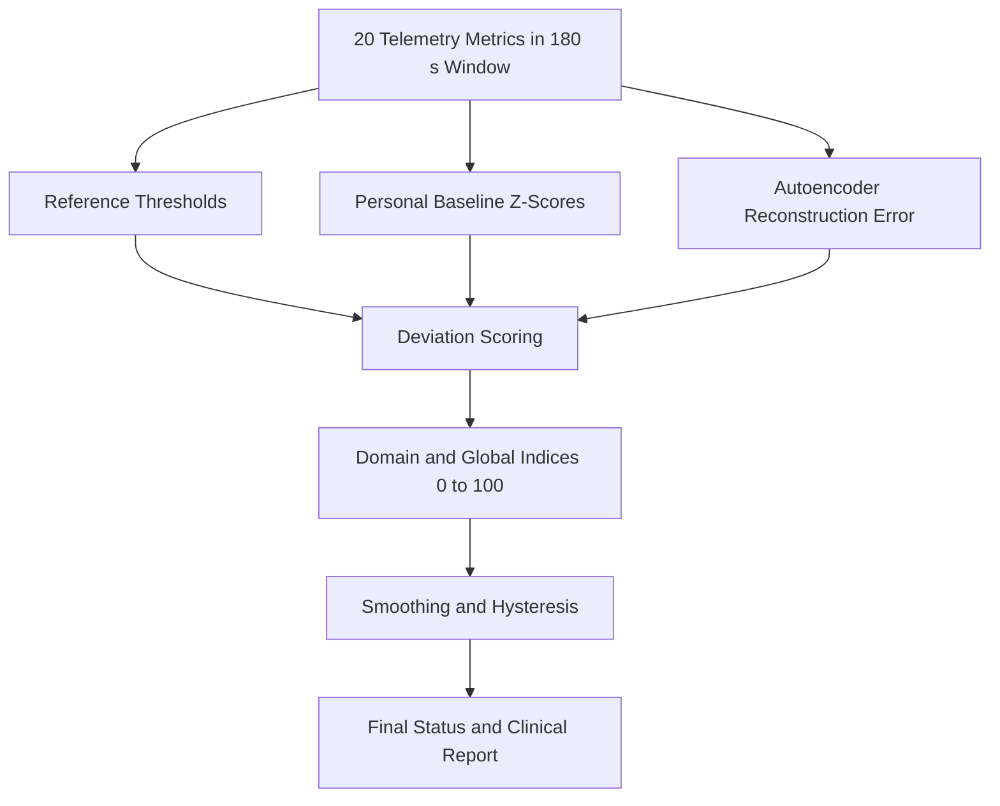
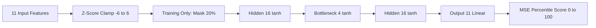

# Core Health Model

The `app/model/` package scores 20 parameters across 7 domains without heavy ML frameworks.

## Scoring Pipeline

Each astronaut has an isolated `Centrum` instance in `app/model/state.py` combining three criteria.

## Three Evaluation Criteria

- Reference thresholds : `thresholds.py` classifies each metric as `norma`, `uwaga`, or `alarm`
- Personal baseline : `personal_baseline.py` updates mean and variance only during `norma` readings
- Signal coherence : `anomaly_model.py` scores reconstruction residuals across 11 paired metrics

## Safeguards and Reporting

- Alert caps : Non-heuristic `alarm` caps global index at 44.0 and `uwaga` caps at 74.0
- Temporal smoothing : Exponential filter with 25.0 s time constant, or 6.0 s on hard alarm
- Hysteresis and dwell : 3.0 pt status hysteresis plus 10.0 s alert raise and 20.0 s clear timers
- Clinical rules : `report.py` flags linked patterns such as high CO2 with low cognitive readiness

## Denoising Autoencoder

`SiecAnomalii` in `app/model/anomaly_model.py` learns normal crew and cabin patterns in pure Python or NumPy.

- Inputs : 8 biometric metrics plus cabin CO2, temperature, and humidity
- Fallback : Before training, `BazaOnline` compares readings against rolling session statistics after 30 samples
- Training : `app/model/train_anomalies.py` trains on `telemetry_history.csv`, `osdr_RR1.json`, and resting profiles, then writes `app/data/anomalies.json`
