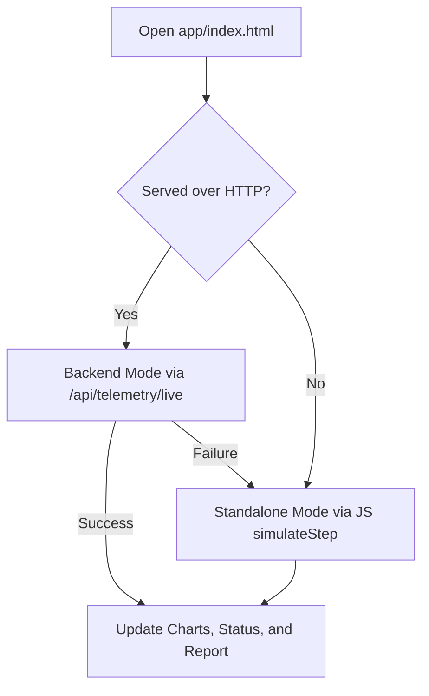
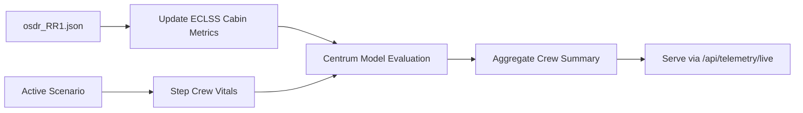

# Program Architecture and Flow

Simple overview of how the HMS-of-A application starts, streams telemetry, and updates the dashboard.

## Two Runtime Modes

The frontend automatically selects Backend Mode when served over HTTP or Standalone Mode when opened directly as a local file.

## Backend Telemetry Loop

When `app/app.py` runs, a background thread generates telemetry packets every 2.0 s by default.

## Operational Modes and Roles

- `demo` mode : Loads 6 preconfigured accounts with Commander oversight and simulated warning/critical crew profiles
- `real` mode : Keeps only the Commander account until crew members are added manually or via simulated Garmin import
- Commander role : Views full crew priority ranking, ECLSS metrics, alerts, and clinical reports
- Astronaut role : Views personal biometrics, daily check-ins, procedures, and motivation metrics

## Key API Endpoints

- `GET /api/state` : Initial mode, user accounts, roster, procedures, schedule, and stream config
- `GET /api/telemetry/live` : Latest packet, crew vitals, ECLSS state, and `crewSummary`
- `POST /api/telemetry/control` : Starts or stops streaming and sets scenario or interval
- `POST /api/telemetry/entry` : Submits manual vitals, ECLSS values, or raw model measurements
- `GET /api/model/summary` : Returns detailed model scores and deviations for crew or one astronaut
- `GET /api/raport.txt` : Exports plain-text English clinical summary report
- `POST /api/garmin/import` : Adds a simulated Garmin telemetry astronaut profile
- `POST /api/mode` and `POST /api/mission/reset` : Switches mode or resets mission state
