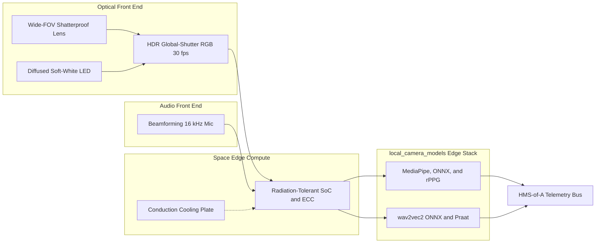
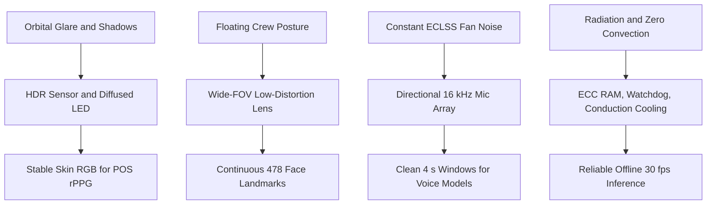

# Space Camera Concept for Edge Models

Conceptual camera and edge hardware design required to run `local_camera_models/` reliably in orbital microgravity.

## Hardware and Edge Architecture

The camera unit captures stable color video and clean speech audio, runs inference locally, and sends lightweight telemetry to HMS-of-A.

## Space Adaptation Logic

Orbital conditions challenge optical and acoustic sensors. Each hardware choice protects one or more edge model requirements.

## Key Camera Requirements

- Sensor : True RGB global-shutter sensor at 30 fps minimum and 640 px width or higher to match `rppg_heart_rate` and `FatigueTracker`
- Exposure lock : Fixed white balance and manual exposure during rPPG capture so skin color oscillations are preserved
- Optics : Wide field of view with shatterproof sapphire or polycarbonate cover for floating astronaut framing and cabin safety
- Lighting : Diffused soft-white illumination to counter harsh sunlight contrast without saturating `64x64` eye and `48x48` face crops
- Audio : Beamforming 16 kHz microphone with hardware noise suppression for `emocje_glos.onnx` and `voice_biomarkers.py`
- Cooling : Thermal conduction into station structure because microgravity prevents natural air convection
- Reliability : Radiation shielding, ECC memory, low-outgassing enclosure, and hardware watchdog for autonomous recovery
- Privacy and link : Local CPU or NPU inference avoids streaming raw video over limited orbital downlinks
